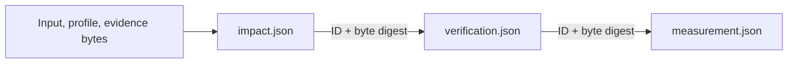

# PULSEmech — Language Relation Impact v0

## 1. Scope and entry points

LRM-04 adds finite grounded support, condition effects and independently bound before/after
observations to the LRM-02 verifier and LRM-03 comparator. Relation states remain in
`measurement.json.results`; impact conclusions are separate. The LRM-01
input/measurement/verification schemas, finite profile and reference corpus remain unchanged.

```bash
python tools/measure_language_relations_v0.py \
  --input /work/package/input.json --package-root /work/package \
  --trust-config /work/source-trust/config.json \
  --comparison-trust-config /work/comparison-trust/config.json \
  --impact-trust-config /work/impact-trust/config.json \
  --output-dir /work/results/lrm04-run
```

`--impact-trust-config` enables impact evaluation. `--with-impact` enables it without requiring an
impact trust configuration; unresolved support/event premises stay explicit. Omitting both options
retains the LRM-03 two-artifact invocation. The output directory must be new. Publication does not
overwrite existing files; a failed publication removes only artifacts owned by that call.

The Python API is `impact.measure_impact_bundle(input_path, *, package_root=None, trust_config=None,
comparison_trust_config=None, impact_trust_config=None)`. It returns `measurement`, `verification`
and `impact` dictionaries.

| Target question | LRM-04 evaluation |
| --- | --- |
| `condition_impact` | The selected conditions' values and the complete joint possibility vectors. |
| `support_preservation` | An independently reviewed claim mapping and support graph, before/after base-evidence withdrawal. |
| `observed_effect` | A separately reviewed, exactly bound before/after event record. |
| Another question, with a non-null `impact_model` | A support evaluation requiring its own explicit reviewed claim mapping. |
| Another question, without an `impact_model` | No new impact target. |

Each target has one question. To measure condition and support facets of the same relation roots,
declare two targets with their own target-local coverage obligations and required reviews. A
model-wide `target_claim_ids` list never silently determines which claims belong to a measurement
target.

## 2. Evidence and assessment boundaries

All modes require bound source/context bytes. A claimed processing change also requires a passing
independent processing binding. An independently rejected source mapping or required comparison
premise blocks the corresponding result. Unknown, empty or truncated interpretation families cannot
produce a successful impact conclusion. An empty compatible family is not vacuous preservation.

Support and observed-event conclusions additionally require accepted source representations, a
passing LRM-03 independent target review, every declared variant represented in the compatible
comparison family, and all of that target's coverage obligations closed. A completed independent
impact review is a further gate. A difference between relation states across otherwise fully checked
variants can leave the relation result unresolved while permitting an orthogonal support/event
conclusion. Missing comparison coverage cannot.

Condition calculations may be identified within `candidate_structures`; this checks the supplied
finite model and does not verify natural-language extraction. `accepted_reference` means
`reference_interpretation`; `profile_verified` means `controlled_source_profile`. Independent review
does not promote either meaning or correspondence to a controlled-profile proof.

Support claims may retain typed quotation, modality or event expressions as opaque claim identities.
The independent scope/rule review must accept their specific meanings and applicable inference
rules. The support engine does not interpret a permission, quotation or proposition as a plain
Boolean assertion. The Boolean condition evaluator keeps unsupported typed contexts unresolved.

`IDENTIFIED` impact rows have `changed` or `preserved`, and named witnesses. `UNBOUND`,
`INCOMPATIBLE` and `UNRESOLVED` rows have `unresolved` and an explanation. Explanatory caveats can
also accompany identified rows. A completed diagnostic run is not a claim that every target was
identified.

## 3. Independently configured records

The operator fixes the trust configuration outside `package_root`. Every payload is outside that
root too; symlinks, unsafe relative paths, duplicate subjects and mismatching byte digests are
rejected. Hashes bind bytes; they do not authenticate the reviewer or make a package's
self-description independent. The schemas are strict: unlisted fields are rejected.

An impact configuration has exactly these fields:

```json
{
  "schema_version": "language_relation_impact_trust_config_v0",
  "review_files": [{"path": "support-review.json", "content_sha256": "REVIEW_SHA256"}],
  "observation_files": []
}
```

Replace `REVIEW_SHA256` with the 64 lowercase hexadecimal SHA-256 digits of the actual review file
bytes. Paths are relative to the configuration directory. Both arrays are required; an observation
uses a separate `observation_files` entry with its own byte pin. Reformatting a file requires
updating its pin.

All review types use `input_ref = {artifact_id, content_sha256}` and `profile_ref = {profile_id,
content_sha256}` matching the exact measured input and frozen profile. `reviewed_variant_ids` must
match the declared joint family. IDs follow `^[A-Za-z][A-Za-z0-9_.:-]{0,127}$` unless specified
otherwise. Every check has these common fields:

```json
{
  "check_id": "independent_check_1",
  "status": "completed",
  "result": "pass",
  "reason": null,
  "evidence_refs": ["independent_evidence_1"]
}
```

These values describe an actually performed independent check; the example syntax supplies no
evidence. `status` is `completed`, `not_run` or `error`. Completed results are `pass`, `fail` or
`unresolved`. Other statuses require `result: null` and a nonempty reason. Failed/unresolved results
require a reason. A passing check without named independent evidence fails admission. Missing or
unperformed required checks stay unresolved; explicit rejection is retained.

### Support review

| Required field | Exact content |
| --- | --- |
| `schema_version` | `language_relation_impact_review_v0` |
| `verification_id`, `target_id` | Unique review ID and the measured target ID. |
| `input_ref`, `profile_ref`, `reviewed_variant_ids` | Exact subjects described above. |
| `mode` | `support` |
| `model_ref` | `{model_id, content_sha256}`; digest is `sha256(canonical_bytes(document["impact_model"]))`, using `io.py`. |
| `claim_ids` | Nonempty explicit mapping to a subset of `impact_model.target_claim_ids`. |
| `scope_check` | Common check plus `context_source_ids`, `correspondence_ids`, `withdrawal_semantics: "remove_base_evidence"`. |
| `base_checks` | Common checks, each additionally naming `claim_id`. |
| `rule_checks` | Common checks, each additionally naming `rule_id` and the exact input rule's `rule_basis_ref`. |
| `observation_ref` | `null` |

The scope check independently accepts the target/claim mapping, scoped claim meanings and types,
applicable context/correspondence, and withdrawal semantics. Context closure includes target
obligations, common variant constraints, claim anchors, entity/domain anchors and nested
relation/proposition references. Every required base and rule needs its own completed passing check.
An input `is_base`, `evidence_refs` or `rule_basis_ref` string cannot admit itself.

Review scope follows all incoming rules to the selected claims, including every conjunctive premise
and alternative route. It also retains exact modeled opponents and their incoming support routes, to
a fixed point. An unknown required route is not dropped to manufacture a closed-world absence
result. Valid unrelated graph components and their failed checks are excluded.

### Observation review and event record

An observed review has the same review fields, with `mode: "observed"`, `model_ref: null`, empty
`claim_ids`, `base_checks` and `rule_checks`, and `scope_check.withdrawal_semantics: null`. Its
`observation_ref` is the object `{observation_id, subject_id, run_id, event_id}`. Subject/run IDs
are nonempty strings of at most 256 characters; they need not be LRM identifiers.

The separately pinned event record has exactly these fields:

| Field | Content |
| --- | --- |
| `schema_version` | `language_relation_impact_observation_v0` |
| `observation_id`, `subject_id`, `run_id`, `event_id` | Exact match to the independent review's observation reference. |
| `input_ref`, `profile_ref`, `target_id`, `reviewed_variant_ids` | Exact measured subjects and variant family. |
| `processing_id` | Exact `document.processing_binding.processing_id`. |
| `before_value`, `after_value` | Required Boolean observations; an after-only record is insufficient. |
| `source_bindings` | Exact source-instance projection described below. |
| `check` | Common independent check plus `method: "independent_event_observation"`. |

`source_bindings` contains exactly the processing binding's before source, after source and every
listed context source. Each row contains `source_id`, `role`, `language`, `revision`,
`content_sha256`, `byte_length`, matching the input source record. All required target context must
be captured. The event record cannot replace the separate LRM-02 processing evidence. The request
must claim `processing_change` before an observation is identified.

## 4. Grounded support and withdrawal

Rules are positive conjunctive implications over explicit claim IDs. A rule fires only when every
premise has a grounded proof. Every admitted alternative acyclic proof route is retained; graph
reachability and an ungrounded cycle supply no base evidence. Equal claim expressions do not merge
claim identities.

Withdrawal removes a claim's direct base seed. Both closures are computed fresh; old derived results
are never after-state seeds. A withdrawn claim can still be derived through an independently
grounded alternative route. The artifact records both closures, support paths, unsupported cyclic
members, withdrawn IDs, lost IDs and retained IDs.

The selected goals' grounded-membership vectors determine `changed` versus `preserved`. Two empty
vectors are preserved with an explicit caveat: they supply no grounded support and establish no
world-level falsity. Read the recorded grounded sets and paths before interpreting a preservation
label.

Opposition is exact raw `A` versus an outer `NOT` containing that same `A`. It uses bounded
iterative structural comparison, without semantic rewriting, reference expansion or a general
negation engine. Opponent scoping does not ground either claim. If both become grounded in a
required scope, the conflict remains recorded and that target's impact is unresolved; no explosion
rule derives unrelated claims. Unrelated conflicting components remain local.

## 5. Conditions and joint possibility

Condition satisfaction compares before and after values under the same common configuration, within
one recorded variant. Changed results require named ground-ATOM valuations that are rechecked
against the selected roots; missing or ambiguous aliases keep the required witness unresolved.

Joint possibility compares complete ordered answer-vector sets for all `condition_impact` targets,
retaining variant partitions. Equal separate target marginals do not imply equal joint vectors.
Conversely, an individual condition may change under a common valuation while its possible-value set
stays equal. The artifact records both questions separately. Preserved results have bounded
exhaustive-derivation witnesses; a changed joint set has a vector/configuration witness absent from
the opposite exhaustive set.

Incomplete group members are never silently dropped. Individual target results can remain useful
when another target or the combined group is unresolved. Differences between declared variants are
not averaged into one invented case.

## 6. Artifacts and reproducible byte bindings



`impact.json` holds target details, optional joint-condition detail, evaluator identity, external
evidence file pins and the configuration digest. It does not hash the final verification or
measurement artifact. Verification records bind the exact canonical impact bytes using its ID and
`lrm04.artifact.<sha256>`; measurement binds the final verification ID and byte digest. Symbolic
witness IDs refer to the measurement's witness records without creating a hash cycle.

The frozen measurement schema receives projected impact rows and witnesses. Its global `support`
field contains the after-closure only when there is exactly one support target and it is identified.
Otherwise inspect per-target sidecar support; the implementation does not merge separate target
models into one. Canonical status axes are retained; accepted event rows do not promote
`causal_status`. All three artifacts retain `authority_effect: "none"` and
`release_authority_activation: false`.

## 7. Explicit bounds

| Boundary | Limit |
| --- | --- |
| Input/trust JSON | 4 MiB per file; depth 80; 100,000 structural nodes. |
| One impact trust configuration | 128 payload files; 16 MiB combined payload bytes. |
| One scoped support model | 256 claims; 256 rules. |
| One support closure | 4,096 proof paths; 65,536 proof combinations; 16,384 tokens per exact expression key. |
| Full-model opposition scan | 4,096 claims; 262,144 structural tokens; 65,536 exact pairs. |
| One condition group | 256 targets; 64 declared joint variants. |
| One condition variant | 256 expanded AST nodes; 12 Boolean atoms; 4,096 common configurations. |
| Additional LRM-04 condition work per bundle | Shared 1,048,576 target-value evaluations across individual targets and the joint calculation. |
| New LRM-04 contribution admission | Shared 2 MiB and 40,000 JSON nodes, conservatively counting repeated detail/projection/check/witness content. |
| Each final canonical artifact | Existing strict reader limits: 4 MiB, 100,000 JSON nodes, depth 80. |

The shared condition counter excludes the preceding LRM-03 comparison. Reservations cannot exceed
its limit; each condition detail records that call's actual contribution. Bound or recursion
failures prevent completed conclusions from partial evaluations.

An oversized target contribution becomes compact unresolved diagnostics, with no partial proof or
identified projection retained. A rejected contribution is not charged against the admission budget,
so a later independent target can still fit. Joint publication is all-or-nothing: no successful
subset replaces the complete vector. Compact group digest references avoid repeating full
target-name lists. For example, a schema-valid 256-claim/255-rule chain with long rule IDs can
produce about 9.5 MiB of transition detail; it now yields readable unresolved diagnostics.

The admission allowance is not a guarantee that the entire bundle fits. Every final canonical
artifact is checked through `strict_json` before `_publish`. An oversized baseline or final
aggregate rejects the call before any file is published. Missing premises, incompatible contexts and
publication/evaluation limits retain explicit diagnostic reasons.

## 8. Implementation, acceptance tests and limits of this delivery

| Source path | Role and reuse |
| --- | --- |
| `tools/language_relation_v0/impact.py` | Optional orchestration, evidence gates, impact projection and acyclic artifact binding. |
| `tools/language_relation_v0/support.py` | Fresh grounded closures, complete alternative paths, cycles, withdrawal and exact conflict reporting. |
| `tools/language_relation_v0/impact_logic.py` | Common-configuration satisfaction and joint-vector evaluation over existing `VariantLogic`. |
| `tools/language_relation_v0/impact_evidence.py` | External exact-subject reviews, target-local scope and separately pinned observation resolution. |
| `tools/language_relation_v0/comparator.py`, `comparison_evidence.py` | Existing relation results, coverage, correspondence, context and witnesses. |
| `tools/language_relation_v0/verifier.py`, `trust.py`, `binding.py`, `io.py` | Existing source/processing acceptance, byte binding, strict JSON and safe filesystem access. |
| `schemas/language_relation_impact_v0.schema.json` | Self-contained strict diagnostic sidecar schema. |
| `schemas/language_relation_impact_evidence_v0.schema.json` | Strict external config/review/observation contracts. |
| `tests/test_language_relation_impact_v0.py` | Synthetic acceptance controls and integrated regressions; registered in both CI test manifests. |

| Planned acceptance | Executable controls in the impact test module |
| --- | --- |
| A16: grounded support | Conjunctive premises, independent admission, unsupported SCCs, alternative paths, fresh withdrawal, rederivation, exact opponent closure and target-local conflicts. |
| A17: justified modeled impact | Rechecked common valuations, equal marginals with different joint vectors, variant disagreement, unnamed atoms, contradictory context and explicit work bounds. |
| A18: bound observed consequence | Two Boolean observations; source/profile/target/variant/processing/subject/run/event mismatch controls; separate independent checks; preserved causal boundary. |

Use the CI-compatible CPython 3.11.16 environment with dependencies from `requirements.txt` and
`pytest`. From the repository root:

```bash
python -c 'import sys; assert sys.version_info[:3] == (3, 11, 16)'
python -m pytest -q tests/test_language_relation_impact_v0.py
python -m pytest -q tests/test_language_relation_contract_v0.py tests/test_language_relation_input_verifier_v0.py tests/test_language_relation_comparator_v0.py
python ci/check_path_refs_exist.py
```

Runtime evaluators do not read expected labels, the reference corpus or test fixtures, and do not
import test modules. Tests may use that corpus as controls. This delivery does not automate
natural-language extraction, authenticate a reviewer, establish causal attribution, certify
independent replay or grant release authority. The H1 measurement-target/repair case still requires
an explicit supported domain mapping; exact identity and supported inference do not establish that a
selected target is suitable for an operational question. See
`PULSEMECH_LANGUAGE_RELATION_MEASUREMENT_v0_PLAN.md` (A16–A18),
`PULSEMECH_LANGUAGE_RELATION_MEASUREMENT_v0_CONTRACT.md`, and
`PULSEMECH_PARADOX_MEASUREMENT_TARGET_AND_REPAIR_CASE_v0.md` for those boundaries.
